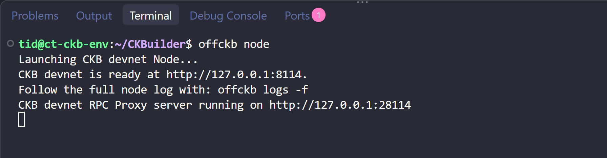
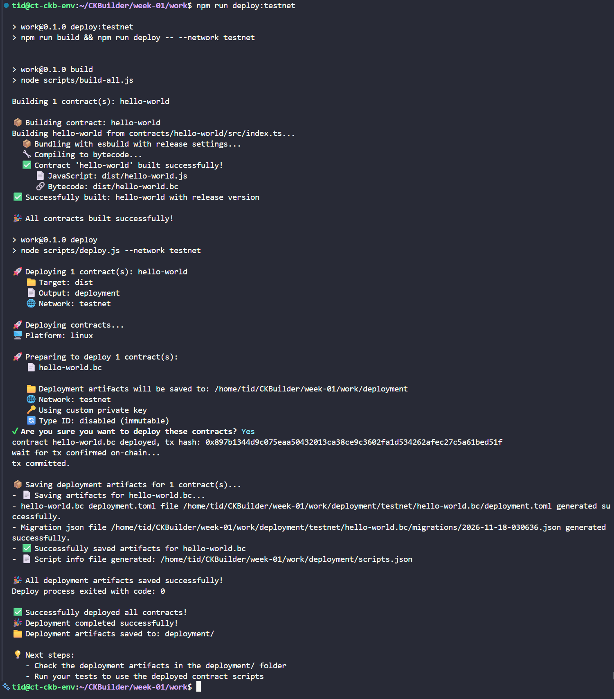
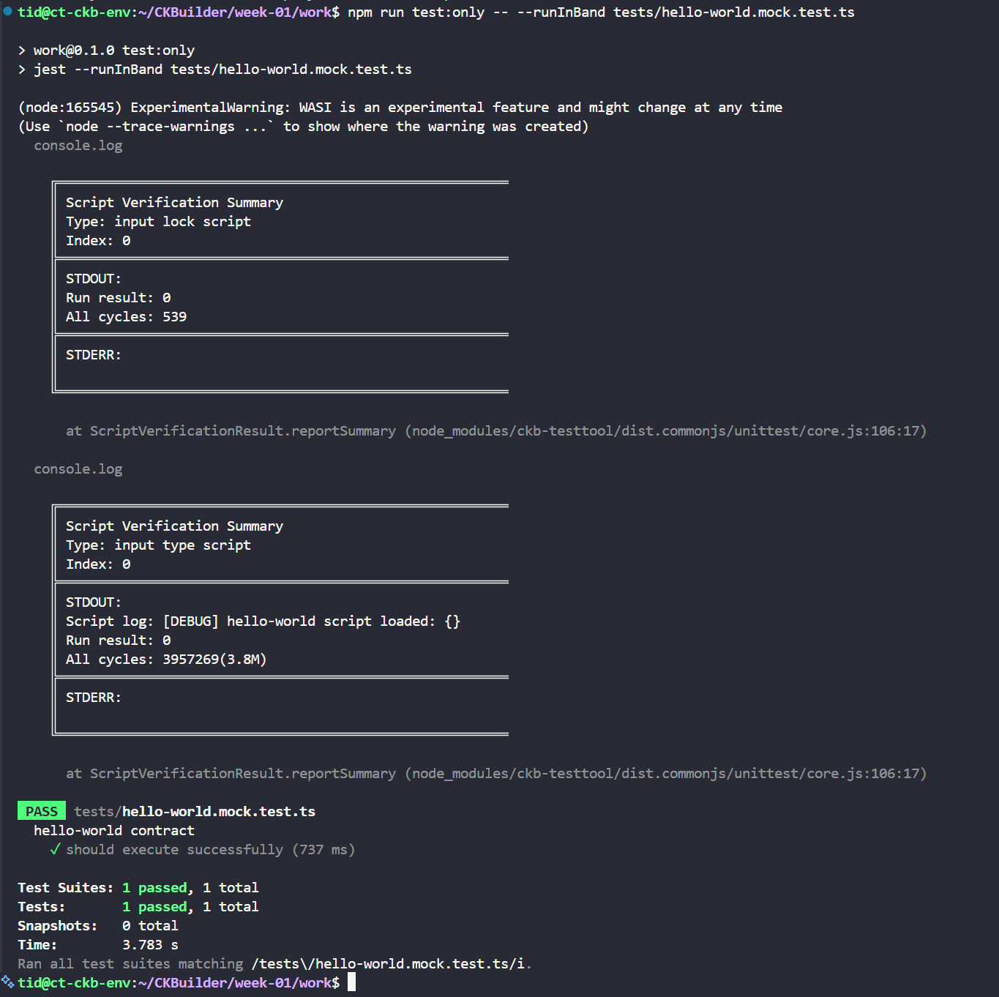
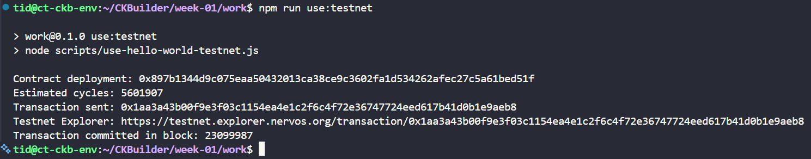

# Builder Track Weekly Report — Week 1

**Name:** dijnie

**Practice date:** November 18, 2026

## Courses and resources

- [How CKB Works](https://docs.nervos.org/docs/getting-started/how-ckb-works)
- [CKB Academy Lessons 1 and 2](https://academy.ckb.dev/courses)
- [Introduction to Script](https://docs.nervos.org/docs/script/intro-to-script)

## Key learnings

- A CKB transaction consumes live input Cells and creates new output Cells. An input's Lock Script checks whether it can be spent. A Type Script can enforce rules on inputs and outputs.
- The deployment transaction stored the contract bytecode in a code Cell. The execution transaction referenced that Cell through `cell_deps` and used `hello-world` as the Type Script on output `0`.
- The mock run printed a WASI experimental warning. I checked the script's return code and the Jest summary to verify the result. The Type Script returned `0`, and Jest reported one passing test.

## Practical progress

- Built the OffCKB TypeScript `hello-world` template into `hello-world.bc`. The [deployment transaction](https://testnet.explorer.nervos.org/transaction/0x897b1344d9c075eaa50432013ca38ce9c3602fa1d534262afec27c5a61bed51f) was confirmed on Pudge Testnet and stored the bytecode at output `0`. [Deployment metadata](work/deployment/scripts.json)
- Ran the `hello-world` mock test. The Type Script used **3,957,269 cycles** in the mock run.
- Sent a separate [execution transaction](https://testnet.explorer.nervos.org/transaction/0x1aa3a43b00f9e3f03c1154ea4e1c2f6c4f72e36747724eed617b41d0b1e9aeb8) on Pudge that used the deployed contract as an output Type Script. It was confirmed in block **23,099,987**. The preflight estimate for the transaction was **5,601,907 cycles**.

## Environment

- **Onboarding** — Completed the local OffCKB setup and deployment. The local node listened on port `8114` and the RPC proxy on `28114`.
- **Week 1 project** — OffCKB, TypeScript, Node.js, npm, Jest, and a shared Pudge Testnet wallet. [Project setup and scripts](work/README.md)

From the repository root, build the contract and run the mock test:

```bash
cd week-01/work
npm ci
npm run build
npm run test:only -- --runInBand tests/hello-world.mock.test.ts
```

With a funded wallet configured through `TESTNET_PRIVATE_KEY_FILE`, the Testnet commands are:

```bash
npm run deploy:testnet
npm run use:testnet -- --dry-run
npm run use:testnet
```

## Evidence

[Full terminal log](evidence/testnet-terminal-log.txt) covering the Testnet deployment, mock test, and execution transaction.

### OffCKB devnet startup



### Pudge Testnet deployment



### Mock test



### Pudge Testnet execution



## Next week

Complete **Transfer CKB** and **Store Data on Cell**, then use RPC to identify the inputs, outputs, and data in a practice transaction.
