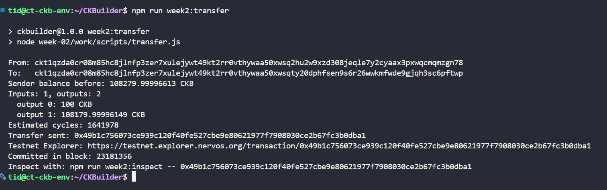
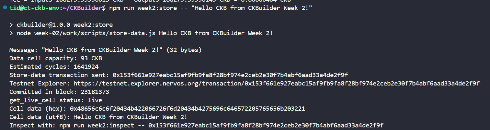
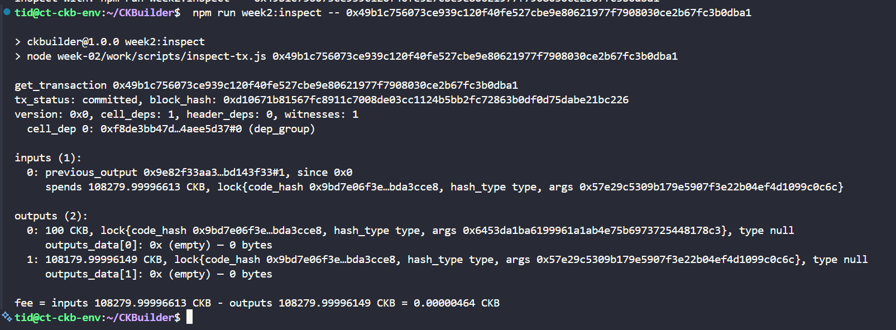
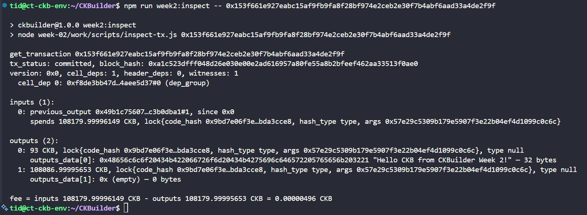

# Builder Track Weekly Report — Week 2

**Name:** dijnie

**Practice date:** November 25, 2026

## Courses and resources

- [Transfer CKB](https://docs.nervos.org/docs/dapp/transfer-ckb)
- [Store Data on Cell](https://docs.nervos.org/docs/dapp/store-data-on-cell)
- [CKB JSON-RPC: `get_transaction` and `get_live_cell`](https://github.com/nervosnetwork/ckb/blob/develop/rpc/README.md)
- [CCC SDK](https://github.com/ckb-devrel/ccc)

## Key learnings

- A transfer creates no new value. It consumes one or more live Cells and creates new Cells whose capacities add up to slightly less than the inputs. The difference is the fee. CCC's `completeInputsByCapacity` picks the inputs, and `completeFeeBy` adds a change output back to the sender.
- A Cell's capacity must cover its own size: 8 bytes for the `capacity` field, 53 bytes for a secp256k1 Lock Script (32 `code_hash` + 1 `hash_type` + 20 `args`), and the data bytes. With no Type Script, a Cell storing a 32-byte message needs at least 8 + 53 + 32 = **93 CKB**. A plain transfer output needs at least 61 CKB.
- RPC fields from `get_transaction`:
  - `inputs[].previous_output` is the `{tx_hash, index}` OutPoint of the Cell being spent. The input does not repeat that Cell's capacity or lock, so the inspector fetches the previous transaction to read them.
  - `inputs[].since` is `0x0` when the input has no time lock.
  - `outputs[]` contains `capacity` (in shannons, hex), `lock`, and `type`. `outputs_data[i]` is the data of `outputs[i]`, so the data is stored in a separate array that runs in parallel to `outputs`.
  - `cell_deps` has one `dep_group` entry that points to the secp256k1 lock code. `witnesses` has one entry that holds the signature.
  - `tx_status` contains `status` (`committed`) and `block_hash`.
- `get_live_cell` with `with_data: true` returns `status: live` and the Cell data under `cell.data.content`. That is how the stored message was read back.
- The two transactions form a chain. The store-data transaction spent output `#1` of the transfer transaction, which was the sender's change Cell.

## Practical progress

- **Transfer CKB.** Sent 100 CKB from the shared Pudge wallet to a second local wallet. The [transfer transaction](https://testnet.explorer.nervos.org/transaction/0x49b1c756073ce939c120f40fe527cbe9e80621977f7908030ce2b67fc3b0dba1) was committed in block **23,181,356**. It had 1 input of 108,279.99996613 CKB and 2 outputs: 100 CKB to the receiver and 108,179.99996149 CKB of change. The fee was 464 shannons, and the estimated cost was **1,641,978 cycles**.
- **Store Data on Cell.** Stored `"Hello CKB from CKBuilder Week 2!"` (32 bytes) in a 93 CKB Cell. The [store-data transaction](https://testnet.explorer.nervos.org/transaction/0x153f661e927eabc15af9fb9fa8f28bf974e2ceb2e30f7b4abf6aad33a4de2f9f) was committed in block **23,181,373**. `get_live_cell` returned the same bytes: `0x48656c6c6f20434b422066726f6d20434b4275696c646572205765656b203221`. The fee was 496 shannons, and the estimated cost was **1,641,924 cycles**.
- **RPC inspection.** `inspect-tx.js` calls the raw JSON-RPC methods so the output shows the node's own snake_case field names. It prints each input with the Cell it spends, each output with its `outputs_data`, and the fee calculated as total input capacity minus total output capacity.

## Environment

- Node.js v26, `@ckb-ccc/core` 1.14, the public Pudge RPC at `https://testnet.ckb.dev`, the shared wallet in `testnet-wallet/pudge.key`, and a receiver wallet in `testnet-wallet/receiver.key`. Git ignores both key files. The receiver key is created the first time the transfer runs. [Scripts](work/README.md)

From the repository root:

```bash
npm ci
npm run week2:transfer -- --dry-run          # add --to <ckt1…> and --amount <CKB> to override
npm run week2:transfer
npm run week2:store -- "Hello CKB from CKBuilder Week 2!"
npm run week2:inspect -- <tx_hash>
```

## Evidence

All transactions are on the Pudge Testnet. Each section below includes the terminal screenshot and the saved output in [`evidence/`](evidence/).

### Transfer CKB

Sends 100 CKB to the receiver wallet. Output `0` is the payment and output `1` is the change back to the sender. [Raw log](evidence/transfer.log)



```text
> ckbuilder@1.0.0 week2:transfer
> node week-02/work/scripts/transfer.js

From: ckt1qzda0cr08m85hc8jlnfp3zer7xulejywt49kt2rr0vthywaa50xwsq2hu2w9xzd308jeqle7y2cyaax3pxwqcmqmzgn78
To:   ckt1qzda0cr08m85hc8jlnfp3zer7xulejywt49kt2rr0vthywaa50xwsqty20dphfsen9s6r26wwkmfwde9gjqh3sc6pftwp
Sender balance before: 108279.99996613 CKB
Inputs: 1, outputs: 2
  output 0: 100 CKB
  output 1: 108179.99996149 CKB
Estimated cycles: 1641978
Transfer sent: 0x49b1c756073ce939c120f40fe527cbe9e80621977f7908030ce2b67fc3b0dba1
Testnet Explorer: https://testnet.explorer.nervos.org/transaction/0x49b1c756073ce939c120f40fe527cbe9e80621977f7908030ce2b67fc3b0dba1
Committed in block: 23181356
Inspect with: npm run week2:inspect -- 0x49b1c756073ce939c120f40fe527cbe9e80621977f7908030ce2b67fc3b0dba1
```

### Store Data on Cell

Creates a 93 CKB Cell holding a 32-byte message, then reads it back with `get_live_cell`. [Raw log](evidence/store-data.log)



```text
> ckbuilder@1.0.0 week2:store
> node week-02/work/scripts/store-data.js Hello CKB from CKBuilder Week 2!

Message: "Hello CKB from CKBuilder Week 2!" (32 bytes)
Data cell capacity: 93 CKB
Estimated cycles: 1641924
Store-data transaction sent: 0x153f661e927eabc15af9fb9fa8f28bf974e2ceb2e30f7b4abf6aad33a4de2f9f
Testnet Explorer: https://testnet.explorer.nervos.org/transaction/0x153f661e927eabc15af9fb9fa8f28bf974e2ceb2e30f7b4abf6aad33a4de2f9f
Committed in block: 23181373
get_live_cell status: live
Cell data (hex): 0x48656c6c6f20434b422066726f6d20434b4275696c646572205765656b203221
Cell data (utf8): Hello CKB from CKBuilder Week 2!
Inspect with: npm run week2:inspect -- 0x153f661e927eabc15af9fb9fa8f28bf974e2ceb2e30f7b4abf6aad33a4de2f9f
```

### RPC inspection: transfer

`get_transaction` shows one input, two outputs with empty `outputs_data`, and a fee of 464 shannons. [Raw log](evidence/inspect-transfer.log)



```text
> ckbuilder@1.0.0 week2:inspect
> node week-02/work/scripts/inspect-tx.js 0x49b1c756073ce939c120f40fe527cbe9e80621977f7908030ce2b67fc3b0dba1

get_transaction 0x49b1c756073ce939c120f40fe527cbe9e80621977f7908030ce2b67fc3b0dba1
tx_status: committed, block_hash: 0xd10671b81567fc8911c7008de03cc1124b5bb2fc72863b0df0d75dabe21bc226
version: 0x0, cell_deps: 1, header_deps: 0, witnesses: 1
  cell_dep 0: 0xf8de3bb47d…4aee5d37#0 (dep_group)

inputs (1):
  0: previous_output 0x9e82f33aa3…bd143f33#1, since 0x0
     spends 108279.99996613 CKB, lock{code_hash 0x9bd7e06f3e…bda3cce8, hash_type type, args 0x57e29c5309b179e5907f3e22b04ef4d1099c0c6c}

outputs (2):
  0: 100 CKB, lock{code_hash 0x9bd7e06f3e…bda3cce8, hash_type type, args 0x6453da1ba6199961a1ab4e75b6973725448178c3}, type null
     outputs_data[0]: 0x (empty) — 0 bytes
  1: 108179.99996149 CKB, lock{code_hash 0x9bd7e06f3e…bda3cce8, hash_type type, args 0x57e29c5309b179e5907f3e22b04ef4d1099c0c6c}, type null
     outputs_data[1]: 0x (empty) — 0 bytes

fee = inputs 108279.99996613 CKB - outputs 108279.99996149 CKB = 0.00000464 CKB
```

### RPC inspection: store data

The input spends the transfer's change Cell (`#1`), and `outputs_data[0]` holds the stored message. [Raw log](evidence/inspect-store-data.log)



```text
> ckbuilder@1.0.0 week2:inspect
> node week-02/work/scripts/inspect-tx.js 0x153f661e927eabc15af9fb9fa8f28bf974e2ceb2e30f7b4abf6aad33a4de2f9f

get_transaction 0x153f661e927eabc15af9fb9fa8f28bf974e2ceb2e30f7b4abf6aad33a4de2f9f
tx_status: committed, block_hash: 0xa1c523dfff048d26e030e00e2ad616957a80fe55a8b2bfeef462aa33513f0ae0
version: 0x0, cell_deps: 1, header_deps: 0, witnesses: 1
  cell_dep 0: 0xf8de3bb47d…4aee5d37#0 (dep_group)

inputs (1):
  0: previous_output 0x49b1c75607…c3b0dba1#1, since 0x0
     spends 108179.99996149 CKB, lock{code_hash 0x9bd7e06f3e…bda3cce8, hash_type type, args 0x57e29c5309b179e5907f3e22b04ef4d1099c0c6c}

outputs (2):
  0: 93 CKB, lock{code_hash 0x9bd7e06f3e…bda3cce8, hash_type type, args 0x57e29c5309b179e5907f3e22b04ef4d1099c0c6c}, type null
     outputs_data[0]: 0x48656c6c6f20434b422066726f6d20434b4275696c646572205765656b203221 "Hello CKB from CKBuilder Week 2!" — 32 bytes
  1: 108086.99995653 CKB, lock{code_hash 0x9bd7e06f3e…bda3cce8, hash_type type, args 0x57e29c5309b179e5907f3e22b04ef4d1099c0c6c}, type null
     outputs_data[1]: 0x (empty) — 0 bytes

fee = inputs 108179.99996149 CKB - outputs 108179.99995653 CKB = 0.00000496 CKB
```
